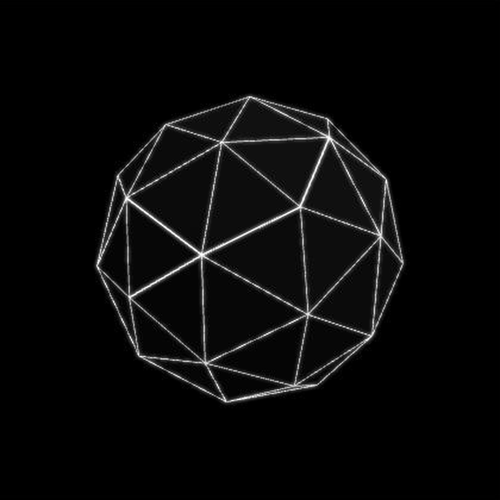

# ARÈS-7

*[Version française](README.fr.md)*

**What if a ship's structure could do more than hold it together?**

A 12-metre sphere. 120 tubes. Two families of 60.

## In 30 seconds

- **What it is:** a concept spacecraft built on a frequency-2 geodesic sphere. Its 120 edges split *by geometry alone* into two families of 60: 60 short radial edges (3.28 m), designed to carry a plasma, and 60 longer inner edges (3.71 m) that carry the load.
- **What is new:** that 60/60 split is not a design choice, it falls out of the icosahedral symmetry. Using it so that the structure would also be a plasma circuit is, as far as we know, an original combination.
- **What blocks it:** power density. The long-term goal is total freedom of movement, which would take 50 to 150 GW on board in about 150 t: **5,000 to 30,000 times** the power density of the most compact fusion drive studied today (Direct Fusion Drive). Physics does not forbid it, but nothing here can be built today, and the dossier says so plainly.

This is **not** a working ship. It is an open invention notebook: every number is labelled with how much we actually know.

| Badge | Meaning |
|---|---|
| 🟢 | established, calculated |
| 🟡 | point of caution |
| 🔵 | unproven, but real physics |
| ⛔ | wall, negative result |

## Find the flaw

Criticism is the point. The open challenges are in [CHALLENGES.md](CHALLENGES.md).
To take one on, or to report a mistake, open an **issue** (tab *Issues*) with your calculation or source. English or French, both are welcome.

## See the project

- **Website (French):** https://ares7-projet.netlify.app
  - `en.html`: ARÈS-7 in one minute, in English
  - `index.html`: the same in French, with an 11-minute documentary
  - `dossier.html`: the full dossier (numbers, calculations, physics, habitat)
  - `lire.html`: the same content as plain text, easy to machine-translate
- **3D views:** the `viewers/` folder (open in any browser)
- **Habitat drawings:** `assets/habitat/`

## Prior art and licence

- Priority: e-Soleau deposit with INPI (France), 6 July 2026.
- Licence: [CC BY-NC-SA 4.0](LICENSE). Share and improve it with credit to the author, no commercial use without permission, share alike.

© J.T.
